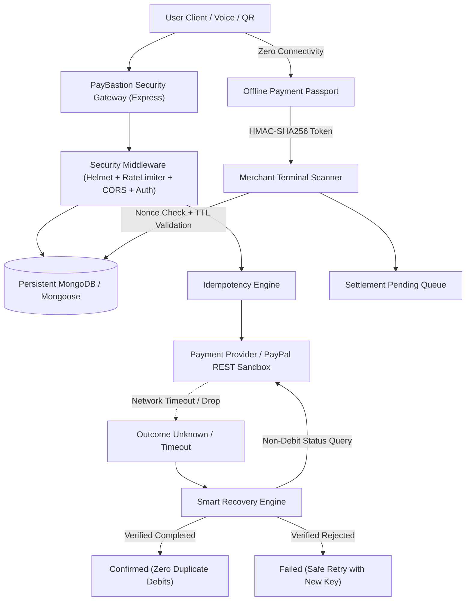

# 🛡️ PayBastion AI — Payment Resilience & Interruption Recovery Platform

[](LICENSE)
[](https://react.dev/)
[](https://nodejs.org/)
[](https://mongoosejs.com/)
[](https://developer.paypal.com/)
[](#security-and-accuracy-invariants)
[](#automated-testing)

> **PayBastion AI** is a production-grade fintech resilience platform designed to eliminate the anxiety of interrupted digital payments, prevent duplicate debits during network timeouts, provide cryptographic offline payment passports, and simulate an emergency credit buffer when banking clearinghouses fail.

---

## 🌟 Hackathon Vision & Core Problem

In modern digital payments (UPI, Card, PayPal), a single transient cell tower drop or a gateway webhook timeout leads to one of fintech's biggest pain points:
> *"Did my payment go through? Should I press Pay again?"*

When users press "Pay" again during an uncertain timeout, they frequently suffer **duplicate debits**. Conversely, when merchants don't receive real-time receipts, service is denied.

**PayBastion solves this with deterministic resilience:**
1. **A payment timeout does NOT prove payment failure.**
2. **Never allow duplicate retries without a non-debit upstream inquiry.**
3. **Never claim an offline authorization is a settled payment.**
4. **AI assists with natural language understanding and explanation — AI never moves money autonomously.**

---

## 🚀 Key Modules & Capabilities

### 1. 🔐 Complete Authentication & JWT Layer
- **Argon/Bcrypt Hashed Security**: Passwords salted and hashed with bcrypt (salt rounds: 10).
- **JWT Authorization**: Cryptographically signed JSON Web Tokens for stateful session persistence.
- **Strict Data Sanitization**: Password hashes, salts, and secret credentials are automatically purged from API responses.
- **Dedicated Middleware**: Rate-limiting on authentication endpoints and token verification via `authMiddleware.js`.

### 2. 💼 Persistent Cyber Wallet & Atomic Peer Transfers
- **Simulated Test Balance**: Prominently demarcated educational demo funds (`balance`, `currency: 'INR'`).
- **4-Digit Hashed PIN**: Security PIN required for initiating wallet transfers, verified using rate-limited endpoints.
- **Atomic Double-Spend Prevention**: Supports multi-document MongoDB transactions where available, with atomic conditional operations fallback for standalone deployments.
- **Full Ledger Receipts**: Every transfer generates immutable audit receipts with idempotency keys and cryptographic references.

### 3. ⚡ Smart Recovery Engine (Zero Duplicate Debits)
- **Deterministic State Machine**: Strictly enforces states (`CREATED`, `PROCESSING`, `CONFIRMED`, `FAILED`, `OUTCOME_UNKNOWN`, `PENDING_VERIFICATION`).
- **Zero Assumed Success**: No transaction is EVER confirmed without explicit affirmative acknowledgment from the upstream provider.
- **Retry Locking**: In-flight or `OUTCOME_UNKNOWN` transactions lock the retry button.
- **Safe Retries**: Once verified as `FAILED` (clearinghouse did not debit), safe retries are permitted exclusively using a **new idempotency key**.
- **Provider Abstraction**: Decoupled `PaymentProvider` interface supporting `PayPalPaymentProvider` and `MockPaymentProvider` (simulating `SUCCESS`, `FAILED`, `PENDING`, and `TIMEOUT`).

### 4. 📴 Offline Payment Passport (Air-Gapped Transactions)
- **Backend-Signed HMAC-SHA256**: Cryptographically signed offline payment tokens with strict 15-minute TTLs.
- **Dynamic QR Code**: Encodes authorization ID, sender, recipient constraint, amount cap (hard-bound to ₹2,000 for safety), and single-use nonce.
- **Replay Attack Defense**: Persistent nonce ledger intercepts and blocks duplicate redemption attempts in real time.
- **Separated Settlement Lifecycle**: Clear progression from `AUTHORIZED` → `ACCEPTED_FOR_SETTLEMENT` → `SETTLEMENT_PENDING` → `SETTLED`.

### 5. 🌐 Official PayPal Developer REST API v2 Sandbox
- **Server-Side REST API v2**: Creates orders (`/v2/checkout/orders`) and captures approved orders (`/v2/checkout/orders/{id}/capture`).
- **Webhook Verification**: Validates PayPal webhook signatures using `/v1/notifications/verify-webhook-signature`.
- **Credential Isolation**: Client ID and secret keys reside strictly on the server and are never exposed to the client bundle.
- **Graceful Fallback**: Clearly labeled demo sandbox mode when test credentials are not entered.

### 6. 🛡️ AI Scam Guardian (Modular Risk Engine)
- **Multi-Factor Fraud Analysis**: Inspects suspicious URLs, IP addresses, phishing UPI handles (e.g., `refund-axis@fake`), and reverse-flow collect requests disguised as refunds (`mode=02`).
- **Database Velocity Tracking**: Computes rapid transaction frequencies in the database to detect automated brute-force attacks.
- **3-Part Rule Breakdown**: Structured warnings specifying `Signal`, `Reason`, and `Recommended Action`.

### 7. 🎙️ VoicePay AI & Gemini Explainer
- **Multilingual Support**: Natural voice recognition and entity extraction in **Kannada (`kn-IN`)** and **English (`en-US` / `en-IN`)**.
- **Deterministic Fallback**: In the absence of an external Gemini API key, PayBastion uses its deterministic financial NLP parser.
- **Explicit Confirmation Invariant**: Voice parsing never executes payments autonomously; explicit confirmation is mandatory.

---

## 🏗️ Architecture & Technology Stack

```
PayBastion Architecture
├── client/                     # Frontend (React 18 + Vite + Tailwind CSS)
│   ├── src/
│   │   ├── components/         # AuthModal, WalletModal, ConfidenceBadge, QrScannerModal, etc.
│   │   ├── context/            # PaymentContext (API-Connected Ledger & State), NetworkContext
│   │   ├── pages/              # Dashboard, OfflinePassport, SmartRecovery, VoicePay, ScamGuardian, etc.
│   │   └── utils/              # Centralized API Client (api.js), WebCrypto HMAC signer
│   └── package.json
├── server/                     # Backend API (Node.js + Express ES Modules + MongoDB)
│   ├── config/                 # database.js (Mongoose + in-memory testing), environment.js
│   ├── controllers/            # authController, walletController, paypalController, recoveryController, etc.
│   ├── models/                 # User, Wallet, Transaction, OfflinePassport, ReconciliationLog, AuditLog, ScamAnalysis
│   ├── middleware/             # authMiddleware, rateLimiter, validateRequest, errorHandler
│   ├── routes/                 # auth, wallet, paypal, recovery, offline, scamGuardian, aiExplainer, credit
│   ├── services/               # paypalClient, recoveryService, walletService, cryptoSigner, scamDetectionService
│   ├── utils/                  # logger, transactionState, idempotency
│   ├── tests/                  # Automated test suites (83 tests across 16 suites)
│   ├── .env.example
│   └── index.js
├── package.json                # Root npm workspaces
└── README.md
```



---

## 🗄️ Database Models Overview (MongoDB & Mongoose)

1. **`User`**: Account identity (`name`, `email` [unique, lowercase], `passwordHash`, timestamps).
2. **`Wallet`**: User balance ledger (`userId` [ref: User], `balance`, `currency`, `pinHash`, `isSimulation`).
3. **`Transaction`**: Immutable payment journal (`transactionId` [unique], `userId`, `provider`, `providerTransactionId`, `amount`, `currency`, `recipient`, `recipientName`, `status`, `idempotencyKey` [unique], `confidenceScore`, `failureReason`, audit trail).
4. **`OfflinePassport`**: Cryptographically signed offline tokens (`userId`, `passportId` [unique], `amount` [max ₹2000], `recipient`, `nonce` [unique], `expiresAt`, `signature`, `status`, `settlementStatus`).
5. **`ReconciliationLog`**: Smart recovery inquiry audit logs (`transactionId`, `previousStatus`, `providerStatus`, `finalStatus`, `verificationTimestamp`, `isSimulation`).
6. **`AuditLog`**: Security and financial event trail (`userId`, `action`, `resourceId`, `detail`, `timestamp`).
7. **`ScamAnalysis`**: Risk assessment history (`userId`, `transactionId`, `riskScore`, `riskLevel`, `detectedReasons`, `metadata`).

---

## 📡 API Endpoints Reference

### Authentication
- `POST /api/auth/register` — Register a new user, hash password, provision wallet.
- `POST /api/auth/login` — Authenticate credentials, issue JWT token.
- `POST /api/auth/logout` — Logout user and invalidate session.
- `GET /api/auth/me` — Retrieve authenticated user profile and wallet.

### Wallet & Transfers
- `GET /api/wallet/balance` — Get current wallet balance.
- `POST /api/wallet/set-pin` — Set or update 4-digit security PIN.
- `POST /api/wallet/verify-pin` — Verify security PIN with rate-limiting.
- `POST /api/wallet/add-demo-funds` — Credit simulated test funds.
- `POST /api/wallet/transfer` — Atomic peer-to-peer simulated transfer with PIN verification.
- `GET /api/wallet/transactions` — List wallet transactions.
- `GET /api/wallet/receipt/:id` — Retrieve transaction receipt.

### Smart Recovery & Resilience
- `POST /api/recovery/register` — Register in-flight transaction with idempotency lock.
- `POST /api/recovery/reconcile` — Query payment provider and reconcile transaction.
- `GET /api/recovery/pending` — List pending transactions requiring reconciliation.

### Offline Payment Passport
- `POST /api/offline/sign` — Sign an offline authorization token using server HMAC secret.
- `POST /api/offline/verify` — Verify token signature, expiry TTL, and replay defense.
- `GET /api/offline/passports` — List all issued offline payment passports.
- `GET /api/offline/journal` — List all merchant terminal scanned authorizations.
- `POST /api/offline/reset-replay-cache` — Reset replay cache (development only).

### PayPal Integration
- `POST /api/paypal/create-order` — Create order via official PayPal REST API v2.
- `POST /api/paypal/capture-order` — Capture approved PayPal order.
- `GET /api/paypal/status/:orderId` — Query live order status directly from PayPal.
- `POST /api/paypal/webhook` — Process and verify PayPal webhook events.

### AI & Scam Guardian
- `POST /api/scam-guardian/analyze` — Multi-factor fraud and phishing analysis.
- `POST /api/ai/explain-state` — Natural language explanation for payment states.
- `POST /api/ai/parse-voice` — Multilingual voice intent parsing (Kannada & English).

---

## ⚡ Quick Start Guide

### Prerequisites
- **Node.js**: v18.0.0 or higher (v20+ recommended)
- **MongoDB**: Local MongoDB instance (`mongodb://127.0.0.1:27017`) or MongoDB Atlas. *(During automated testing, an isolated in-memory MongoDB is provisioned automatically).*

### 1. Configure Environment Variables

Copy the template from `server/.env.example` to `server/.env`:

```bash
cd server
cp .env.example .env
```

Contents of `server/.env`:
```env
PORT=5000
NODE_ENV=development
CLIENT_ORIGIN=http://localhost:5173
CLIENT_URL=http://localhost:5173

MONGODB_URI=mongodb://127.0.0.1:27017/paybastion
DATABASE_PATH=./data/paybastion.db

JWT_SECRET=your_jwt_secret_min_32_characters_long!
JWT_EXPIRES_IN=24h

PAYPAL_MODE=sandbox
PAYPAL_CLIENT_ID=your_paypal_sandbox_client_id
PAYPAL_CLIENT_SECRET=your_paypal_sandbox_secret
PAYPAL_WEBHOOK_ID=your_paypal_webhook_id

GEMINI_API_KEY=your_gemini_api_key
OFFLINE_PASSPORT_SECRET=5088bdbcaebcf56acaa29273f6cb4f44aa6ddb37c37f8110cbc64f6334504d94
```

### 2. Run Automated Testing

Execute the comprehensive 83-test verification suite across all backend modules:

```bash
npm test
```

Expected result:
```
# tests 83
# suites 16
# pass 83
# fail 0
# cancelled 0
# skipped 0
```

### 3. Start the Application

You can start both frontend and backend concurrently from the root directory:

```bash
npm run dev
```

Or run them in separate terminals:

**Terminal 1 (Backend Server):**
```bash
cd server
npm start
# Server running at http://localhost:5000
```

**Terminal 2 (Frontend Client):**
```bash
cd client
npm run dev
# Frontend running at http://localhost:5173
```

Open **`http://localhost:5173`** in your browser.

---

## 💳 PayPal Sandbox Setup Guide

1. Log in to the [PayPal Developer Dashboard](https://developer.paypal.com/dashboard/).
2. Under **Apps & Credentials**, toggle to **Sandbox**.
3. Click **Create App** and select **Merchant** application type.
4. Copy your **Client ID** and **Secret**.
5. Paste them into `server/.env`:
   ```env
   PAYPAL_MODE=sandbox
   PAYPAL_CLIENT_ID=your_actual_client_id
   PAYPAL_CLIENT_SECRET=your_actual_client_secret
   ```
6. Restart the server (`npm start`). PayBastion will automatically authenticate and cache OAuth2 tokens.

---

## 🔒 Security and Accuracy Invariants

1. **A payment timeout does not prove payment failure.**
2. **Always verify original provider status before permitting any retry.**
3. **Never allow a simulated transaction to appear as a real bank settlement.**
4. **Offline authorization is not confirmed settlement.**
5. **Single offline authorization ceiling strictly capped at ₹2,000.**
6. **Unique nonces and cryptographic replay prevention on all offline tokens.**
7. **Secrets remain strictly in server environment variables and are never leaked.**
8. **Deterministic transaction verification — AI assists with understanding, not moving money.**

---

## 📄 License
This project is open-source under the [MIT License](LICENSE).
